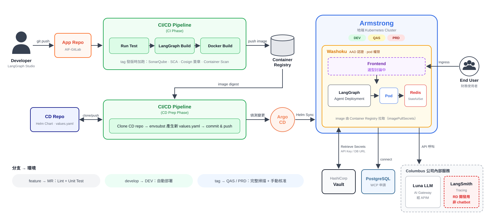

# AI_Prepare — 財務 AI Agent 導入準備

記錄「財務 agent 家園」從**資源申請**到 **CI/CD 上線**的整體規劃與目前進度，給團隊成員與主管對齊用。

> 最後更新：2026/10/14
> 參考資料：《權限申請與 Helm 部屬流程（手把手教學）》2026/09/08、《Release Management SOP 2024》、[tech_study.md](docs/tech_study.md)（Multi-Repo vs Monorepo 評估）、[gitlab_flow.md](docs/gitlab_flow.md)（分支與部署流程）、[wicop.md](docs/wicop.md)（WiCOP 申請紀錄）、[Columbus 3.3.0 技術資源申請_API](https://wistron.sharepoint.com/sites/PoweredbyColumbus/SitePages/3.3.0_%E6%8A%80%E8%A1%93%E8%B3%87%E6%BA%90%E7%94%B3%E8%AB%8B_API.aspx)（API token 申請）

## 結論

- **目前進度**：[ASP 專案與用例](https://asportal.wistron.com/project-management/project-list/project-detail?ucId=274&pjGroup=175)已建立（資源群 `finaiagent`／資源名稱 `finagent`）；AAD App Registration [`FIN_AI_Agent`](https://portal.azure.com/#view/Microsoft_AAD_RegisteredApps/ApplicationMenuBlade/~/Overview/appId/5d17156a-8009-416c-9219-f932d7c982ab/isMSAApp~/false) 已建立；[AIF-GitLab group](https://aif-gitlab.wistron.com/ai-platform/projects/finaiagent) 已建立；[WiCOP](docs/wicop.md) 已送出申請（Namespace `finagent`）；LLM（Luna／Columbus）、LangSmith 先沿用現有資源。
- **程式碼放哪裡**：統一放在 `aif-gitlab.wistron.com/ai-platform/projects/finaiagent/finagent/`，source code 和 helm 分成兩個 repo（Multi-Repo）。
- **怎麼上線**：GitLab CI 測試、掃描、build image → 更新 Helm Repo → Argo CD 自動部署到 Armstrong（地端 K8s；DEV 自動，QAS／PRD 手動核准）。
- **下一步**：等 WiCOP 核准的同時，申請 WCP（PostgreSQL）、建立 `finagent` subgroup 並 fork 範本；Namespace 下來後再申請 Helm Repo 串接和 SRE 申請單。
- **後端已確定**：LangGraph Agent Server（搭配 PostgreSQL＋Redis）部署在 Armstrong。**前端還沒決定，目前討論中** → 見[第 5 節](#5-前端選型討論中)。

> [!CAUTION]
> ## 🚨🚨 LangSmith ≠ Chatbot 🚨🚨
>
> ### LangSmith 是 **RD 開發／除錯用的後台 UI**，**不能**部署給財務同仁使用！
>
> | | 🛠️ LangSmith／LangGraph Studio | 💬 給財務同仁的前端 |
> |---|---|---|
> | **給誰用** | RD（開發者） | 財務使用者 |
> | **用途** | 看 trace、debug、跑評測 | 問問題、上傳發票、看檢查結果 |
> | **能不能給使用者用** | ❌ **不行** | ✅ 這才是要做的 |
> | **現在有沒有** | ✅ 已經有 | ⏳ **還沒有，要另外開發** |
>
> ⛔ **請不要把 LangSmith 或 Studio 的連結當成產品給使用者。** 使用者要用的畫面，請看[第 5 節前端選型](#5-前端選型討論中)。



---

## 1. 專案基本資訊（ASP）

本專案已在 **AI Service Portal（ASP）** 建立專案與用例（2026/10/12）：[ASP 專案頁面](https://asportal.wistron.com/project-management/project-list/project-detail?ucId=274&pjGroup=175)。ASP 是公司的 AI 專案管理平台，GitLab group、LangSmith、Helm repo 等資源都掛在 ASP 的專案／用例底下，**名稱必須一致**。

| 層級 | 欄位 | 值 |
|---|---|---|
| ASP 專案（專案群） | 專案名稱 | 財務agent家園 |
| | **資源群名稱** | `finaiagent` |
| | 專案所屬領域 | 財務 |
| ASP 用例 | 用例名稱 | FIN-AI-AGENT |
| | **資源名稱** | `finagent` |
| | Owner | CHINGYI CHUEH |
| | Project Code | IB202512.506（IT-IT-BI Operation Sustain Support, 2026 TSS） |
| | Charge Dept | ML0000 |
| WiCOP | Namespace／IBU | `finagent`／`ARMWHQFinAgentP`（[申請紀錄](docs/wicop.md)） |
| AAD | App Registration | [`FIN_AI_Agent`](https://portal.azure.com/#view/Microsoft_AAD_RegisteredApps/ApplicationMenuBlade/~/Overview/appId/5d17156a-8009-416c-9219-f932d7c982ab/isMSAApp~/false)（App ID `5d17156a-8009-416c-9219-f932d7c982ab`） |

> [!NOTE]
> **ASP ≠ APIM。** ASP（AI Service Portal）管理專案和資源；APIM（Azure API Management）是 Luna/LLM 的 API 閘道，對應 `.env` 裡的 `OCP_APIM_SUBSCRIPTION_KEY`。

---

## 2. GitLab 規劃

之後所有程式碼統一放在 **aif-gitlab.wistron.com**，專案群 group：[ai-platform/projects/finaiagent](https://aif-gitlab.wistron.com/ai-platform/projects/finaiagent)。GitLab 的層級對應 ASP 的命名：

```
aif-gitlab.wistron.com/ai-platform/projects/
└── finaiagent/            ← ASP 專案群（資源群名稱），由 ASP 建立 ✅
    ├── agent-template     ← ASP 建立時一起產生的 repo ✅
    └── finagent/          ← ASP 用例（資源名稱），需自行建立 subgroup，名稱須與 ASP 一致
        ├── <source repo>  ← Agent 程式碼（由 columbus agent 範本 fork）
        ├── <helm repo>    ← K8s 部署設定（由 columbus helm 範本 fork）
        └── <frontend repo>← 前端（選型中，見第 5 節）
```

- Repo 結構採 **Multi-Repo**：每個應用的 source code 和 helm 分開放，這也是 Release Management SOP 的標準結構。比較請見 [tech_study.md](docs/tech_study.md)。
- 範本來源：`aif-gitlab.wistron.com/columbus1/pro-code/` 底下的 `agent`（LangGraph agent + pipeline 範本）和 `helm`（agent-helm chart），建議用 **fork** 帶進 `finagent/`。
- GitLab 權限和 group 申請由 TL 處理。

---

## 3. 資源申請流程與進度

依《手把手教學》，申請分三個 Phase。下表 ✅＝完成，🔜＝下一步要做，🔄＝沿用現有或進行中，⏳＝待申請。

### Phase 1 · 申請權限與資源（可並行）

| # | 項目 | 申請管道 | 負責 | 狀態 |
|---|---|---|---|---|
| 1 | AAD 帳號、AAD 服務與導入 | 先在 ITSR（Azure AD－應用程式管理）申請，再到 Washoku 綁定 pod 認證 | TL | ✅ App Registration [`FIN_AI_Agent`](https://portal.azure.com/#view/Microsoft_AAD_RegisteredApps/ApplicationMenuBlade/~/Overview/appId/5d17156a-8009-416c-9219-f932d7c982ab/isMSAApp~/false) 已建立<br>⏳ Washoku 綁定 |
| 2 | AI Use Case（專案＋用例） | AI Service Portal → 新建專案，需填 Project Code 或 Charge Dept | TL | ✅ 2026/10/12（[ASP 專案頁面](https://asportal.wistron.com/project-management/project-list/project-detail?ucId=274&pjGroup=175)） |
| 3 | AIF-Gitlab 權限與 ASP 專案群 Group | ITSR：「AIF-Gitlab 服務－權限申請」＋「ASP 專案群 Group 申請」，完成後會收到信件 | TL | ✅ [finaiagent group](https://aif-gitlab.wistron.com/ai-platform/projects/finaiagent) |
| 4 | Armstrong（地端 K8s）Namespace | [WiCOP](https://wicop.wistron.com/wicop/applicationForms/applyStatus) New Account Combo（[教學](https://cloud-guidebook.wistron.com/developer/01_Kickoff-a-project/1.1_Setting-up-accounts/)） | TL | 🔄 2026/10/14 已送出（ApplyNo `20261014C0005`，目前在 COG PIC Audit），IBU `ARMWHQFinAgentP`、Namespace `finagent`，**先只開 PRD**（[申請紀錄](docs/wicop.md)） |

### Phase 2 · 建立專案與服務（可並行）

| # | 項目 | 申請管道 | 負責 | 狀態 |
|---|---|---|---|---|
| 5 | Database（PostgreSQL） | WCP | TL | ⏳ **需要**：LangGraph Agent Server 要用 PostgreSQL 存 thread／checkpoint（Redis 會隨 helm chart 部署） |
| 6 | Columbus AI Gateway LLM 模型閘道使用權 | DSP（[API token 申請說明](https://wistron.sharepoint.com/sites/PoweredbyColumbus/SitePages/3.3.0_%E6%8A%80%E8%A1%93%E8%B3%87%E6%BA%90%E7%94%B3%E8%AB%8B_API.aspx)） | TL | 🔄 沿用現有 |
| 7 | Columbus 模型使用 | ITSR（[API token 申請說明](https://wistron.sharepoint.com/sites/PoweredbyColumbus/SitePages/3.3.0_%E6%8A%80%E8%A1%93%E8%B3%87%E6%BA%90%E7%94%B3%E8%AB%8B_API.aspx)） | TL | 🔄 沿用現有（QAS／PRD key） |
| 8 | LangSmith（RD 開發用 UI） | ASP → 資源管理 → AgentOps → Pro-Code 頁籤 → 資源申請 | TL | 🔄 沿用現有 |
| 9 | 建立專案 Git（fork 範本） | 在 `finaiagent/finagent/` 底下建 subgroup 和 repo | TL | 🔜 可開始 |

### Phase 3 · 開發與部署（依序）

| # | 項目 | 說明 | 負責 | 狀態 |
|---|---|---|---|---|
| 10 | 本機開發與測試 | LangGraph Studio 本機開發 | TL／Dev | 🔄 進行中 |
| 11 | 設置 Vault 服務 | Secret 改存 Vault，不放進 repo | TL | ⏳ |
| 12 | 接入可觀測性 | LangSmith tracing | TL／Dev | 🔄 |
| 13 | AIF-Gitlab Helm Repo 與 Armstrong（地端 K8s）串接 | ITSR，提供 Namespace 和 Helm Chart repo 路徑（路徑名稱須與 ASP 資源群和資源名稱一致） | TL | ⏳ 等 #4、#9 |
| 14 | AIF CI/CD Pipeline、Helm repo 設置與部署 | 見第 4 節 | TL | ⏳ |

### Release Management 額外要準備的項目

上線前，TL 需要向 **SRE team** 提供專案資訊，並在 pipeline 中加入安全掃描，以符合 GitSecOps／DSOMM 規範：

| 項目 | 內容 | 狀態 |
|---|---|---|
| DevSecOps-Argo 申請單 | Project Name、AAD TL Group／AAD RD Group、Subscription、K8s Namespace、Helm Chart repo 路徑與分支對應 | ⏳ |
| GitLab Group Access Token | Group → Settings → Access Tokens 建立 `RMTOKEN`，並在 repo 的 CI/CD Variables 設定 `RMTOKEN`、`DOCKER_USERNAME` | ⏳ |
| SonarQube project key／token | 設定 `SONAR_PROJECTKEY`、`SONAR_TOKEN`、`SONAR_HOST_URL`，repo 根目錄加入 `sonar-project.properties` | ⏳ |
| 簽章金鑰 | `COSIGN_KEY`／`COSIGN_PUB`（image 簽章） | ⏳ |

> [!WARNING]
> SOP 範例用的是 devpack 平台（`gitlab.devpack.cc`、`sonarqube.devpack.cc`）。換到 AIF-Gitlab 後，對應的 SonarQube／ArgoCD 位址需要再向 SRE 確認。

---

## 4. 整體架構（大框架）

### 4.1 系統組成

架構圖見[開頭的結論](#結論)。

架構參考 AIF CI/CD Pipeline（手把手教學第 17 頁）：

| 階段 | 做什麼 |
|---|---|
| **CI Phase** | App Repo push 後觸發：Run Test → LangGraph Build → Docker Build，image 推到 Container Registry。tag 發版時加跑 SonarQube、SCA、Cosign 簽章、Container Scan |
| **CD Prep Phase** | 取得 image digest → clone CD Repo（Helm Chart）→ 用 `envsubst` 產生新的 `values.yaml` → commit & push |
| **CD（Argo CD）** | 偵測 CD Repo 變更 → Helm Sync 到 Armstrong 對應環境（DEV／QAS／PRD） |
| **Runtime** | Washoku 負責 AAD 認證與 pod 權限；LangGraph Agent Deployment 產生 Pod，搭配 Redis；連 PostgreSQL；從 Vault 取 secrets（API Key／DB URL） |
| **Columbus** | 公司內部服務：透過 APIM 呼叫 Luna LLM；trace 送到 LangSmith（僅 RD 使用） |

### 4.2 GitLab Flow（分支、MR、部署）

| 分支／觸發 | 環境 | 部署方式 |
|---|---|---|
| feature → MR | — | 只跑 lint 和 unit test |
| `develop` | DEV | 自動部署 |
| Git tag | QAS → PRD | 完整安全掃描，手動核准部署 |

完整流程（MR 規則、發版步驟、pipeline 內容、CI 變數）請見 **[docs/gitlab_flow.md](docs/gitlab_flow.md)**。

---

## 5. 前端選型（討論中）

後端已確定是 **LangGraph Agent Server**，前端只要能呼叫它的 API（threads／runs、streaming）就能串接。以下是候選方案：

| 方案 | 語言 | 優點 | 缺點 | 適合 |
|---|---|---|---|---|
| **A. Agent Chat UI**（LangChain 官方開源，Next.js） | TypeScript | 原生對接 LangGraph Server：streaming、tool call 顯示、human-in-the-loop（interrupt）都現成 | 需要 Node.js 技能；AAD SSO 要自己接（MSAL／NextAuth） | 以聊天為主，想最快上線 |
| **B. Chainlit** | Python | 純 Python，團隊好上手；內建 Azure AD OAuth、檔案上傳、streaming | 版面客製化有限；要自己寫呼叫 LangGraph API 的程式 | Python 團隊做聊天介面 |
| **C. Streamlit／Gradio** | Python | PoC 最快，幾十行就能 demo | 多人併發、SSO、版面都弱，不適合正式上線 | 內部 demo、驗證需求 |
| **D. 自建 React／Next.js** | TypeScript | 完全客製：可做表單、審核清單、表格等非聊天介面 | 開發和維護成本最高 | 需求不只是聊天（例如發票審核工作台） |
| **E. 嵌入既有管道**（Teams bot、既有財務系統） | 視系統而定 | 使用者不用換工具 | 需另外申請 Teams／Bot 資源，限制多 | 使用者主要在 Teams 工作 |

### 討論時要先回答的問題

1. **使用情境**：是「聊天問答」，還是「上傳發票 → 看檢查結果清單」的工作台？
2. **使用者規模**：幾個人用？要不要分權限（AAD 群組）？
3. **誰維護前端**：團隊目前以 Python 為主，有沒有人能維護 TypeScript？
4. **人工確認**：agent 判斷後是否需要使用者按「確認／退回」（human-in-the-loop）？

> [!TIP]
> **初步建議**：如果是聊天為主，先用 **A. Agent Chat UI** 做 PoC，它跟 LangGraph Server 是同一套，串接成本最低。如果團隊希望全部用 Python 維護，改用 **B. Chainlit**。需求偏向審核工作台的話，再評估 **D. 自建前端**。
>
> 不論選哪個方案，前端都需要自己的 repo、helm 和 pipeline，會在 `finaiagent/finagent/` 底下多一個 `<frontend repo>`。

---

## 6. 下一步

1. 追蹤 WiCOP 核准（#4），核准後取得 Onboarding Pack；確認 [wicop.md 的待確認事項](docs/wicop.md#待確認事項)
2. 到 WCP 申請 PostgreSQL（#5）
3. 在 `finaiagent/` 底下建 `finagent` subgroup，並 fork agent 和 helm 範本（#9）
4. Namespace 下來後，到 ITSR 申請 Helm Repo 與 K8s 串接（#13）
5. 送 DevSecOps-Argo 申請單，準備 RMTOKEN、SonarQube、Cosign 等 CI 變數
6. 把 `.env` 的 secrets 搬到 Vault 和 GitLab CI/CD Variables
7. **決定前端方案**（第 5 節）
