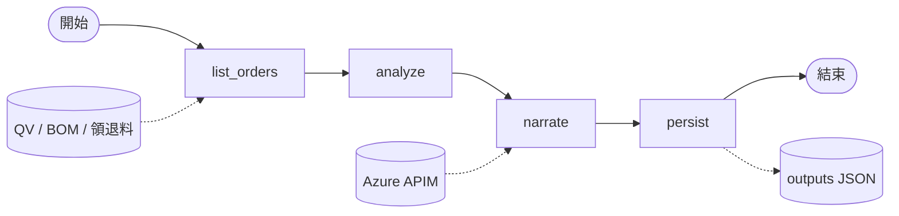
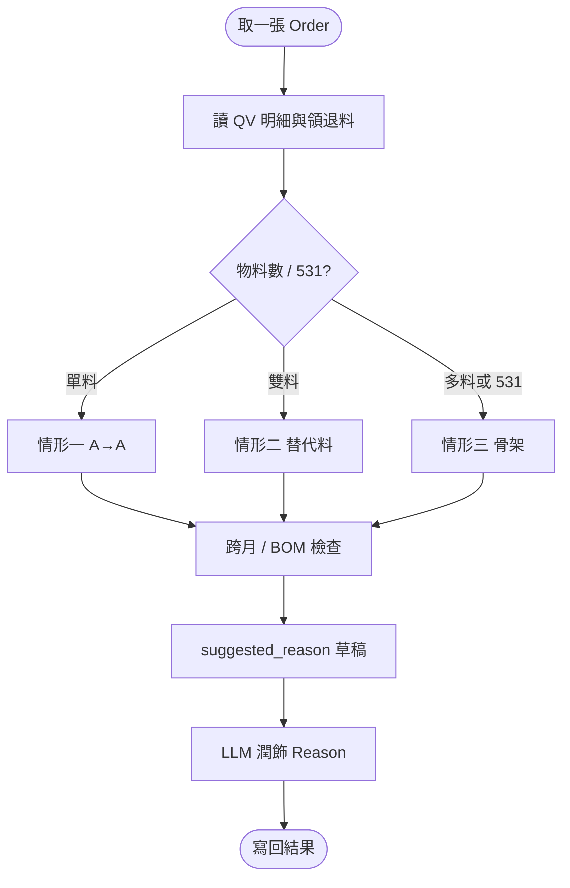

# 【範本／本機】Rework MO 小偵探（`rework_mo_detective`）

> 非正式環境紀錄。對應程式：`server/flows/graphs/rework_mo_detective/`；測試資料：`server/testdata/rework_mo/`。

| 項目 | 內容 |
|------|------|
| Graph ID | `rework_mo_detective` |
| 程式 | `server/flows/graphs/rework_mo_detective/` |

預覽：`Ctrl+Shift+V`（建議 `Markdown Preview Mermaid Support`）。

## A. 目前可跑的 LangGraph

## B. 單張工單分析邏輯

