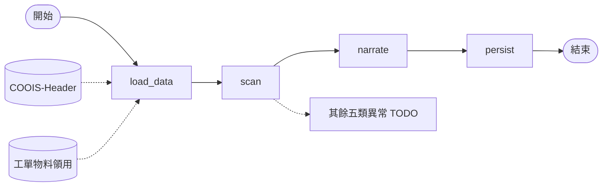
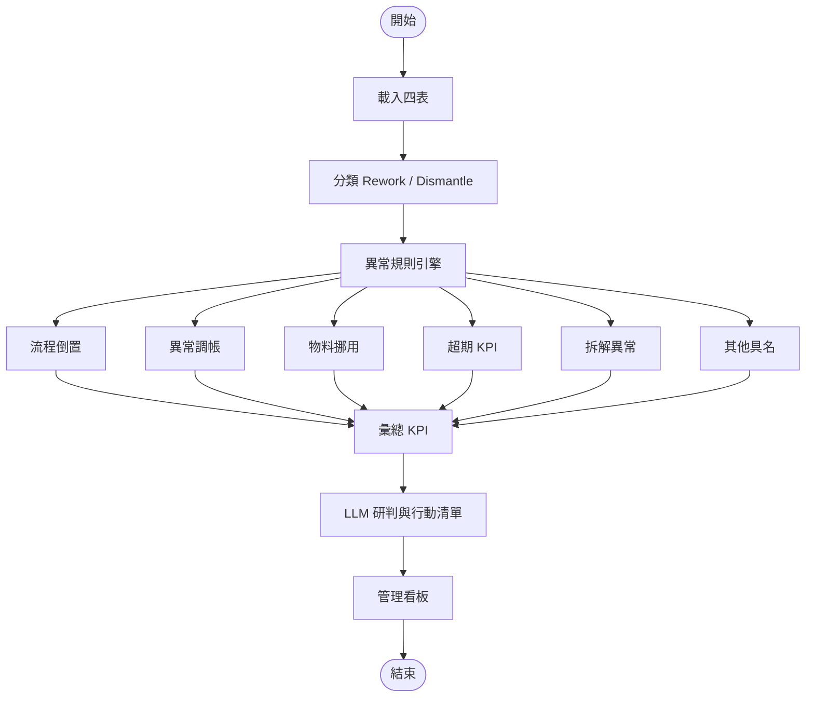

# 【範本／本機】Rework&Dismantle 風險看板（`rd_risk_dashboard`）

> 非正式環境紀錄。對應程式：`server/flows/graphs/rd_risk_dashboard/`；測試資料：`server/testdata/rd_risk/`。

| 項目 | 內容 |
|------|------|
| Graph ID | `rd_risk_dashboard` |
| 程式 | `server/flows/graphs/rd_risk_dashboard/` |

預覽：`Ctrl+Shift+V`。

## A. 目前可跑的 LangGraph（MVP）

## B. 完整規格目標（六類異常 → 看板）

