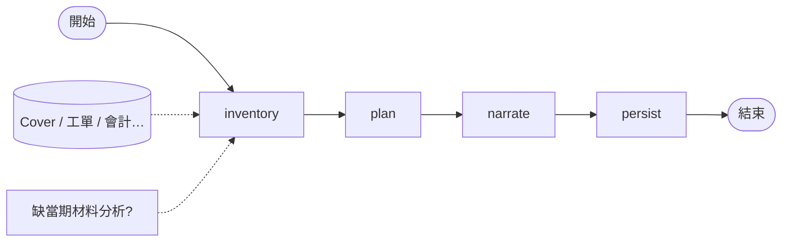
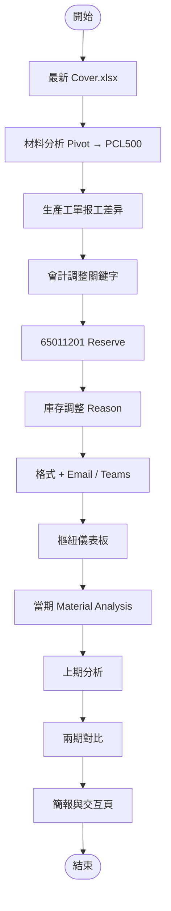

# 【範本／本機】QV DMS 整理及分析（`qv_dms_pipeline`）

> 非正式環境紀錄。對應程式：`server/flows/graphs/qv_dms_pipeline/`；測試資料：`server/testdata/qv_dms/`。

| 項目 | 內容 |
|------|------|
| Graph ID | `qv_dms_pipeline` |
| 程式 | `server/flows/graphs/qv_dms_pipeline/` |

預覽：`Ctrl+Shift+V`。

## A. 目前可跑的 LangGraph（MVP）

## B. 完整規格：Cover 回填 → 分析 → 交付

