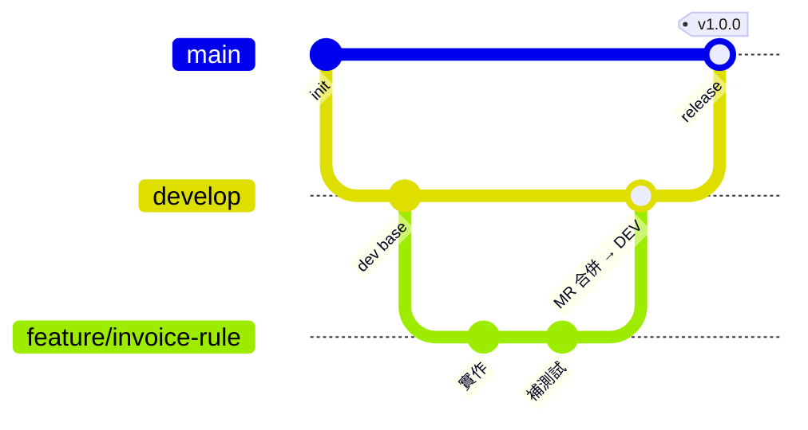
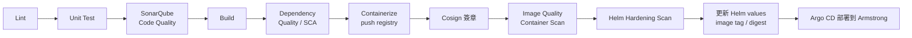

# GitLab Flow — 分支、MR 與部署流程

說明 `finagent` 專案從寫程式到部署上 Armstrong（地端 K8s）的 Git 流程。

> 依據：`columbus1/pro-code/agent` 的 pipeline 範本（`.gitlab-ci.yml`、`pipeline/`），以及《Release Management SOP 2024》的分支策略。
> 回到 [README](../README.md)

---

## 1. 分支與環境對應

| 分支／觸發 | 環境 | 會跑什麼 | 部署方式 |
|---|---|---|---|
| `feature/*` 建 MR | — | Lint、Unit Test | 不部署 |
| `develop` | DEV | 完整 CI：build、containerize | **自動**更新 dev Helm values → Argo CD 同步 |
| Git tag | QAS → PRD | 完整 CI ＋ 安全掃描、Cosign 簽章 | **手動**按下 QAS／PRD deploy job |

---

## 2. 日常開發（MR flow）

1. 從 `develop` 開分支：`feature/<簡短描述>` 或 `fix/<簡短描述>`
2. 本機開發，用 LangGraph Studio 測試，並補上 pytest
3. push 後建立 **MR → `develop`**，pipeline 會自動跑 lint 和 unit test
4. 至少一位成員做 code review，pipeline 通過才能 merge
5. merge 進 `develop` 後自動部署到 **DEV**，在 DEV 驗證

> [!TIP]
> 開發前先 `git pull --rebase` 同步 `develop`，減少衝突。

---

## 3. 發版（Release）

1. DEV 驗證完成後，把 `develop` 合併到 `main`（建議透過 MR，由 TL 核准）
2. 在 `main` 打 tag，例如 `v1.0.0`，觸發 release pipeline
3. Release pipeline 會跑完整安全掃描（見下一節），產生已簽章的 image
4. TL **手動**執行 `qas-deploy`，部署到 QAS，由使用者驗收（確認 AC）
5. 驗收通過後，TL **手動**執行 `prd-deploy` 上線 PRD

> [!NOTE]
> RM SOP 範例的 tag 命名是 `prd-v1.0.0-20221221` 這種格式。實際格式等 SRE 申請時再確認，確認後更新這裡。

---

## 4. CI/CD Pipeline 內容

> **現況（本 repo）**：`lint`（ruff）+ `verify`（`pytest server/tests/domain`，不呼叫 LLM）+ build／promote。下表含長期目標能力（Sonar／Cosign 等），尚未全部啟用。  
> **正式部署**：僅 `langgraph.json` 的 `agent`；業務 graphs／`testdata` 不進正式執行契約（pytest 仍測 `flows/domain`）。

| Stage | 內容 | MR | develop | tag |
|---|---|:-:|:-:|:-:|
| test | Lint（ruff）、Unit Test（pytest domain） | ✅ | ✅ | ✅ |
| 安全掃描 | SonarQube、Dependency Quality（SCA） | | | ✅ |
| build／containerize | `langgraph build`，push 到 GitLab Container Registry | | ✅ | ✅ |
| 簽章與掃描 | Cosign 簽章、Image Quality、Container Scan | | | ✅ |
| deploy | 更新 Helm Repo 的 values（image tag／digest） | | 自動 | 手動 |

- deploy 階段就是 **CD Prep Phase**：拿到 image digest → clone CD Repo（Helm Chart）→ 用 `envsubst` 產生新的 `values.yaml` → commit & push，接著 Argo CD 偵測到變更就 Helm Sync 到 Armstrong。
- 掃描結果會回傳 Jira（SonarQube quality gate、container status）。
- Helm repo 的 template 要先配置 `imagePullSecrets`，Argo CD 才能從 registry 拉 image。

---

## 5. 需要設定的 CI/CD Variables

在 Source Repo 的 **Settings → CI/CD → Variables** 設定，**不要寫進程式碼**：

| 變數 | 用途 |
|---|---|
| `CI_DEPLOY_USER`／`CI_DEPLOY_PASSWORD` | 讀寫 Registry 和 Helm repo |
| `AGENT_CLIENT_ID_*`／`AGENT_CLIENT_SECRET_*` | 各環境的 AAD service principal（DEV／QAS／PRD） |
| `APM_TENANT_ID` | Azure tenant |
| `COSIGN_KEY`／`COSIGN_PUB` | image 簽章 |
| `RMTOKEN`、`DOCKER_USERNAME` | Release Management 要求的 group access token |
| `SONAR_PROJECTKEY`／`SONAR_TOKEN`／`SONAR_HOST_URL` | SonarQube 掃描 |

---

## 6. 權限

| 角色 | Argo CD 可見範圍 |
|---|---|
| AAD TL Group | DEV／QAS／PRD 全部 |
| AAD RD Group | 只有 DEV |
