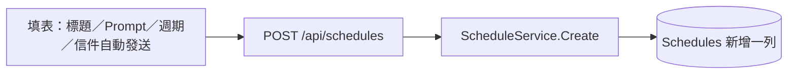
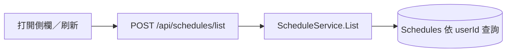
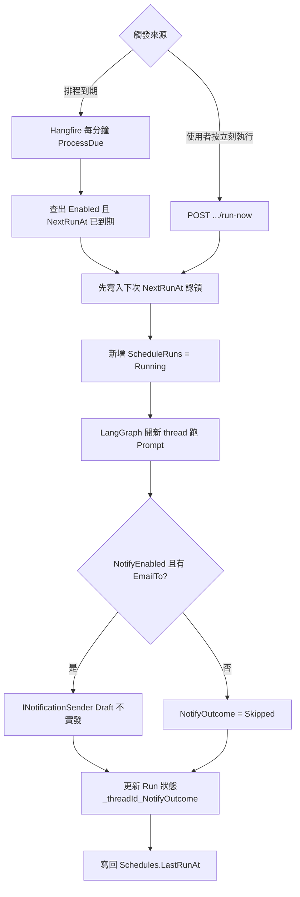

# 流程 1：使用者設定排程後 — API 與 DB 協作

本機：Chat UI → Scheduler Api（`:5055`）→ SQLite；到期由 Job（`:5056`）掃描並呼叫 LangGraph；可選通知（本機 **Draft 不實發**）。  
業務 API **統一 POST**（查詢亦同；僅 `/health` 用 GET）。  
另見：[schedule-deploy.md](schedule-deploy.md)、[schedule-db.md](schedule-db.md)｜[`scheduler/README.md`](../scheduler/README.md)

> 預覽：`Ctrl+Shift+V`。圖仍太小可在預覽中放大，或安裝 `bierner.markdown-mermaid`。

---

## 流程圖（建立與列表）

使用者在 UI 操作時，API 只負責把「排程定義」寫進／讀出資料庫；此時**還不會**跑 AI、也**不會**寄信。  
業務 API 一律 POST；下面**兩支路徑用途不同**（一寫一讀）。

### POST ① 建立排程（寫入）

按「建立／儲存」→ 新增一列 `Schedules`（含 Prompt、週期、信件自動發送開關）。

### POST ② 列出排程（查詢）

打開側欄或刷新 → 依 body 的 `userId` 查詢個人排程；**不會**新建排程。若上次執行等待確認，會向 LangGraph 查詢並同步該執行狀態。

為什麼列表也是 POST：專案約定查詢也走 POST（`userId` 放 body）；路徑是 `/list`，與①的 `/api/schedules` 不同，不會互相覆蓋。

---

## 流程圖（到期執行或立刻執行）

真正跑 AI 時，Job 的 due-scanner 與 UI 的「立刻執行」走**同一條** `IScheduleRunExecutor`。  
LangGraph 結束後，若 `NotifyEnabled` 且有 `EmailTo`，再走 **確定性** `INotificationSender`（本機 Draft）。

排程的 thread 與 run metadata 都標記 `source=schedule`。「信件自動發送」預設關閉，執行到 `send_mail` 時停在確認卡；`runs/wait` 回傳 2xx 後仍查詢 thread 狀態，記錄 `WaitingForConfirmation=4`（`finishedAt=null`），不當作已完成。從側欄點排程名稱可開啟該 thread 確認或取消；之後查詢排程／執行紀錄會同步完成狀態。查詢 LangGraph 失敗會回報錯誤，不冒稱完成。

開啟並儲存 `autoSendMail=true`，即授權下一次起的排程自動寄信。後端從資料庫讀取開關注入該次 run 的 configurable，LLM 不能從工具參數開啟；不以持久化 thread metadata 授權後續一般聊天。既有 `notifyEnabled` 是另外的執行結果 Draft 通知，與此開關不同。詳見[寄信功能](./mail.md)。

週期數值維持向後相容：`Daily=0`、`Weekly=1`、`EveryNHours=2`，新增 `Monthly=3`。每月使用 `dayOfMonth`（1–31，省略預設 1）與 `timeOfDay`，以 Asia/Taipei 計算；該月無此日期則在月底執行，隔月仍依原日期計算。建立／更新的 `autoSendMail` 省略時分別為 false／不變。EF Migration 為既有資料增加欄位，不清除排程。

---

## 圖下說明（請對照圖）

### A. 「設定排程」階段在做什麼？

| 步驟 | 誰做 | 結果 |
|------|------|------|
| 使用者填表 | Chat UI | 標題、Prompt、每日／每週／每月／每 N 小時；信件自動發送預設關閉 |
| `POST /api/schedules` | Scheduler Api | 強制 `Scope=User`（一般使用者建不出公司排程） |
| 寫入 DB | `ScheduleService` | 一列 `Schedules`，含首次 `NextRunAt`、`Enabled=true`、可選 `NotifyEnabled`／`EmailTo`／`EmailCc` |
| `POST /api/schedules/list` | 同一 Api | body 帶 `userId`；**只**列出該使用者個人排程；看不到 `Scope=Company` |

此時資料庫裡只有「以後要跑什麼」，**沒有**執行紀錄、也還沒呼叫 LangGraph／通知。

### B. 「執行」階段在做什麼？

| 步驟 | 為什麼這樣做 |
|------|----------------|
| Hangfire 每分鐘掃一次 | 系統只養**一條**掃描 Job，不是每個使用者一條 RecurringJob |
| 先更新 `NextRunAt`（認領） | 避免兩台 Job 同時撿到同一列、跑兩次 |
| 寫 `ScheduleRuns` | 留下 Running → Succeeded／Failed 與錯誤訊息 |
| 呼叫 LangGraph | 用排程的 Prompt 當一則 human message，開**新** thread |
| 通知（可選） | **程式**決定是否呼叫 `INotificationSender`；**不**交給 LLM 判斷。本機 `Notification:Mode=Draft` **永不實發** |
| 寫回 `threadId`／`NotifyOutcome` | UI 可開對話；維運可看草稿摘要 |

「立刻執行」跳過「等到期」，但仍走認領 → Runs → LangGraph → 通知 → 寫回，與掃描器相同。

### C. 和公司排程的差別（同一套管線）

- 公司任務也是 `Schedules` 的列，只是 `Scope=Company`，由維運／internal API 建立。
- 一般列表 API **永不**回傳公司列。
- 設定 `CompanySchedules:Enabled=false` 時，**週期掃描**會跳過公司列；手動 `run-now` 仍可執行（維運用）。

### D. 本機怎麼對一下？

1. Api／Job 腳本見 `scheduler/README.md`  
2. DB 預設：`D:\ai_prepare_data\schedules.sqlite`  
3. 列表：`POST http://127.0.0.1:5055/api/schedules/list`，body `{"userId":"local-demo-user"}`  
4. 執行紀錄：`POST .../api/schedules/{id}/runs/list`（看 `notifyOutcome`，應為 `Draft:…` 或 `Skipped:…`）
