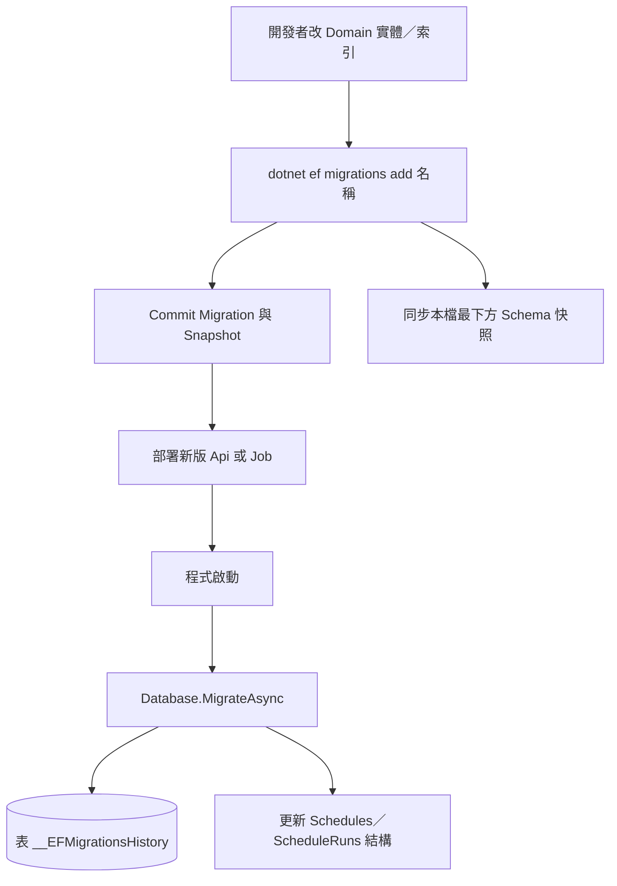
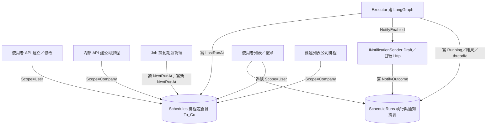

# 流程 3：DB 更新與資料使用（預估）

說明兩件事：（1）欄位／索引怎麼演進（EF Migration）；（2）執行期各表被誰讀、誰寫。  
本機現況：SQLite + 啟動時 `Database.MigrateAsync()`；正式預估：PostgreSQL + 另產 Npgsql Migration。

另見：[schedule-api.md](schedule-api.md)、[schedule-deploy.md](schedule-deploy.md)

> 預覽：`Ctrl+Shift+V`。圖太小請用預覽縮放。  
> **SQLite 不便查看時**：請直接看本檔**最下方「現行 Schema 快照」**；短時間有欄位變更時一併改該段。

---

## 流程圖（Schema 怎麼更新）

改程式裡的實體 → 產生 Migration 檔 → 進版控 → 部署後**啟動時自動套用**，不必手工對正式庫跑 DDL（緊急除外）。

---

## 流程圖（執行期資料怎麼流動）

---

## 圖下說明（請對照圖）

### A. 兩張表各存什麼？

| 表 | 存什麼 | 一列代表 |
|----|--------|----------|
| **Schedules** | 標題、Prompt、週期、`UserId`、`Scope`、`Enabled`、通知 To／Cc、`NextRunAt`、`LastRunAt` | **一筆排程定義**（個人或公司） |
| **ScheduleRuns** | 狀態、錯誤、`ThreadId`、`NotifyOutcome`、開始／結束時間 | **該排程的一次執行** |

沒有「每個使用者一條 Hangfire Job」這種資料；週期任務全靠 `Schedules.NextRunAt`。

### B. 重要欄位怎麼用？

| 欄位 | 寫入時機 | 讀取時機 |
|------|----------|----------|
| `Scope` | 建立時固定（公開 API→User；internal→Company） | 列表過濾；due 是否含公司 |
| `NextRunAt` | 建立／改週期／**每次認領先推進** | Job 判斷「到期了沒」 |
| `Enabled` | Patch 啟停 | due 掃描只看啟用中 |
| `NotifyEnabled`／`EmailTo`／`EmailCc` | 建立／Patch | Executor 決定是否走通知 |
| `LastRunAt` | 執行結束 | UI 顯示上次跑的時間 |
| `ScheduleRuns.ThreadId` | LangGraph 成功 | 打開排程產生的對話 |
| `ScheduleRuns.Status` | Running → Succeeded／Failed | 除錯、側欄紀錄 |
| `ScheduleRuns.NotifyOutcome` | 通知步驟結束 | 本機驗 Draft／Skipped；正式查是否實發 |

### C. Schema 更新（加欄）實際要注意什麼？

1. **本機／正式都不要用**舊的 `EnsureCreated` 加欄（加不出新欄）。  
2. 改實體後執行 `dotnet ef migrations add …`，把產生的檔 commit。  
3. 部署後只要 **Api 或 Job 有跑 `MigrateAsync`**，空庫或舊庫會自動追上。  
4. 本機若 DB 是很早以前 EnsureCreated、沒有 `__EFMigrationsHistory`：備份後刪 sqlite 再啟動最省事。  
5. 換成 **PostgreSQL** 時：換 `UseNpgsql`，並為 PG **重新產生** Migration；不要假設 SQLite 的 migration 檔可直接套用。  
6. **每次改表／欄**：同步更新本檔最下方「現行 Schema 快照」。

### D. 「資料使用」日常情境對照

| 你想做的事 | 會碰到的資料 |
|------------|----------------|
| 使用者新增每日 09:00 任務 | 新增一列 `Schedules`（User） |
| 側欄看到自己的排程 | `POST /api/schedules/list` 讀 `Schedules` where UserId＋Scope=User |
| 到點自動跑 | Job 讀到期列 → 寫 Runs → 打 LangGraph →（可選）Draft 通知 → 更新 Runs／LastRunAt |
| 維運加公司固定任務 | internal API 寫 `Scope=Company`（可帶 EmailTo／Cc） |
| 暫時停公司自動跑 | 設 `CompanySchedules:Enabled=false`（不刪列） |
| 查某次跑失敗原因 | 看該 `ScheduleId` 的 `ScheduleRuns.Error` |
| 查通知有沒有走到 | 看 `ScheduleRuns.NotifyOutcome`（`Draft:…`／`Skipped:…`） |

### E. 和 LangGraph／Checkpoint DB 的關係

- **排程庫**（本文件的 Schedules／Runs）：誰要跑、何時跑、跑的結果摘要、通知摘要。  
- **LangGraph 的 PostgreSQL／checkpoint**（若已申請）：對話 thread 狀態、圖執行細節。  
- 兩者透過 `threadId` 連結；排程庫**不**取代 Agent 的 checkpoint 庫。

---

## 現行 Schema 快照（暫代 SQLite 檢視）

> 對齊 Migration：`InitialCreateWithScope` + `AddScheduleNotificationFields`（2026-11-05）。  
> SQLite 型別以 EF 為準（Guid／DateTimeOffset／bool／enum 多存 TEXT／INTEGER）。  
> **有改實體就改這裡**，短時間內以此為準。

### 表 `Schedules`

| 欄位 | 型別（概念） | 可空 | 說明 |
|------|----------------|------|------|
| `Id` | Guid | N | PK |
| `UserId` | string(128) | N | 擁有者；公司列常用 `company` |
| `Scope` | enum int | N | `0=User`／`1=Company` |
| `Title` | string(200) | N | 標題（亦當通知主旨前綴） |
| `Prompt` | string | N | 給 LangGraph 的 human message |
| `AssistantId` | string(128) | N | 預設 `agent` |
| `ApiUrl` | string(512) | N | LangGraph base URL |
| `Kind` | enum int | N | Daily／Weekly／EveryNHours |
| `TimeOfDay` | TimeOnly | Y | 日／週觸發牆鐘時間 |
| `Weekday` | DayOfWeek? | Y | 每週用 |
| `IntervalHours` | int? | Y | 每 N 小時 |
| `TimeZone` | string(64) | N | 預設 `Asia/Taipei` |
| `Enabled` | bool | N | due 掃描過濾 |
| `NotifyEnabled` | bool | N | 是否走通知管線 |
| `EmailTo` | string(1024) | Y | 收件 To（`,`／`;` 多分隔） |
| `EmailCc` | string(1024) | Y | 副本 Cc |
| `NextRunAt` | DateTimeOffset | N | 下次到期（UTC） |
| `LastRunAt` | DateTimeOffset? | Y | 上次執行結束 |
| `CreatedAt` | DateTimeOffset | N | 建立時間 |
| `UpdatedAt` | DateTimeOffset | N | 最後更新 |

**索引**

- `IX_Schedules_Enabled_NextRunAt`（`Enabled`, `NextRunAt`）
- `IX_Schedules_Scope_Enabled_NextRunAt`（`Scope`, `Enabled`, `NextRunAt`）
- `IX_Schedules_UserId`（`UserId`）

### 表 `ScheduleRuns`

| 欄位 | 型別（概念） | 可空 | 說明 |
|------|----------------|------|------|
| `Id` | Guid | N | PK |
| `ScheduleId` | Guid | N | 所屬排程（無 FK 強制） |
| `Status` | enum int | N | Pending／Running／Succeeded／Failed |
| `ThreadId` | string(128) | Y | LangGraph thread |
| `Error` | string | Y | 失敗訊息 |
| `NotifyOutcome` | string(512) | Y | `Skipped:…`／`Draft:to=…;cc=…`／`Failed:…` |
| `StartedAt` | DateTimeOffset | N | 開始 |
| `FinishedAt` | DateTimeOffset? | Y | 結束 |

**索引**

- `IX_ScheduleRuns_ScheduleId`（`ScheduleId`）

### 表 `__EFMigrationsHistory`

| 欄位 | 說明 |
|------|------|
| `MigrationId` | 已套用的 migration 名稱 |
| `ProductVersion` | EF 產品版本 |

本機若看不到此表且欄位對不上：備份後刪 `SCHEDULE_DB_PATH`（預設 `D:\ai_prepare_data\schedules.sqlite`）再啟動 Api／Job。
