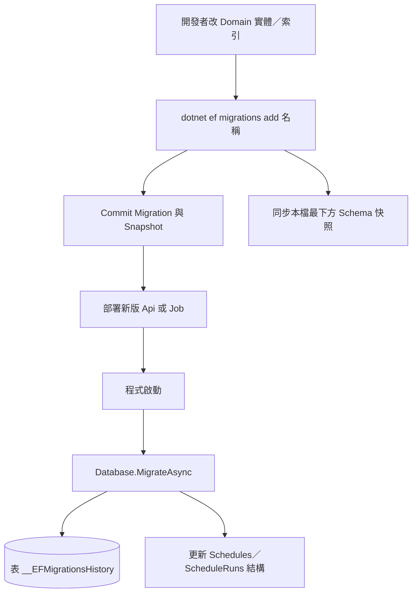
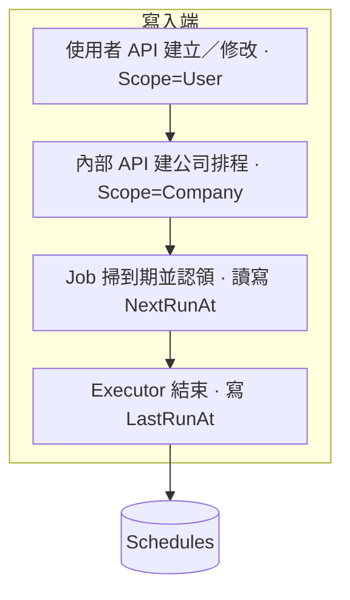
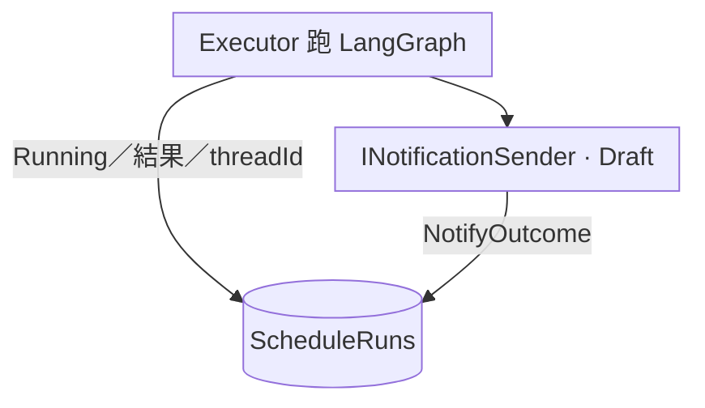
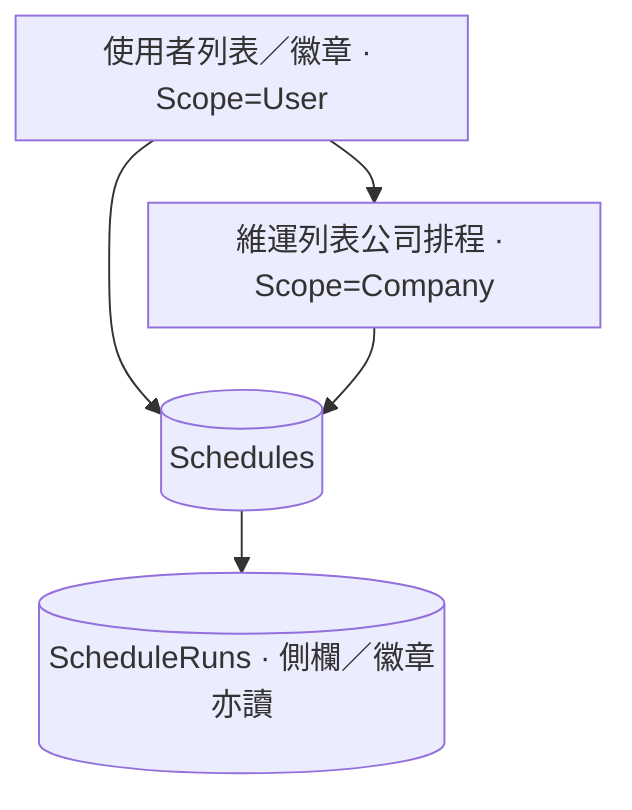

# 流程 3：DB 更新與資料使用

說明兩件事：（1）欄位／索引怎麼演進（EF Migration）；（2）執行期各表被誰讀、誰寫。  
**現況**：QAS PostgreSQL（schema **`public`**）+ 啟動時 `Database.MigrateAsync()`。本機與部署共用同一契約：`SCHEDULE_DB`（部署＝Vault／Secret Value；本機可明文放 Development／環境變數）。  
**DB 表／欄**：`snake_case`（如 `schedules.user_id`），並有 PostgreSQL `COMMENT`；C# 實體仍 PascalCase，由 EF `UseSnakeCaseNamingConvention` 對應。

另見：[schedule-api.md](schedule-api.md)、[schedule-deploy.md](schedule-deploy.md)

---

## 命名規範（前後端／API／DB）

依各層「官方文件示例＋主流社群慣例」分層，**不要**整條鏈路硬套同一種寫法。

| 層級 | 慣例 | 本專案例子 | 依據摘要 |
|------|------|------------|----------|
| **PostgreSQL 表／欄** | 小寫 **`snake_case`**；表名複數 | `schedules`、`user_id`、`next_run_at` | PG 文件示例為 `my_first_table`／`first_column`；未加引號會折成小寫；Supabase／社群 style guide 採 snake_case |
| **C# Domain／DTO 屬性** | **`PascalCase`** | `UserId`、`NextRunAt` | .NET 命名指引 |
| **HTTP JSON（Scheduler API↔前端）** | **`camelCase`** | `userId`、`nextRunAt` | ASP.NET Core 預設 JSON；前端 `schedule-api.ts` 註明 camelCase |
| **LangGraph／Python payload** | **`snake_case`**（與上游一致） | `user_id`、`graph_id` | LangGraph／Python 慣例；見 `LangGraphHttpClient` 的 `SnakeCaseLower` |
| **環境變數／Secret 鍵** | **`SCREAMING_SNAKE`** | `SCHEDULE_DB`、`SCHEDULE_JOB_KEY` | 常見 ops／12-factor 慣例 |
| **enum／常數（C#）** | PascalCase 成員 | `ScheduleScope.User` | .NET |
| **前端 TS 變數／型別欄位** | camelCase（型別名 PascalCase） | `userId`、`ScheduleDto` | TypeScript／React 主流 |

對照流程：

```text
UI TS camelCase  ←JSON→  API DTO PascalCase（序列化 camelCase）
                         ↓ 對應
                      Domain PascalCase
                         ↓ EF SnakeCaseNamingConvention
                      PG snake_case + COMMENT
```

**不要**：在 PG 用 camelCase／PascalCase（需雙引號、易踩大小寫坑）；不要在 JSON API 改成 snake_case 除非全站一併遷移。

> 預覽：`Ctrl+Shift+V`。圖太小請用預覽縮放。  
> 表結構亦可查本檔最下方「現行 Schema 快照」，或以 Cursor MCP `scheduler-pg`（`SCHEDULE_DB_URL`）唯讀查詢。

---

## 流程圖（Schema 怎麼更新）

改程式裡的實體 → 產生 Migration 檔 → 進版控 → 部署後**啟動時自動套用**，不必手工對正式庫跑 DDL（緊急除外）。



---

## 流程圖（執行期資料怎麼流動）

採**上→下單欄**（子圖 `direction TB`），避免多源橫向匯流把圖拉寬、預覽壓縮到看不清。共三段。

### 1. 誰寫入 `Schedules`



### 2. 誰寫入 `ScheduleRuns`（含通知）



### 3. 誰讀這兩張表



---

## 圖下說明（請對照圖）

### A. 兩張表各存什麼？

| 表 | 存什麼 | 一列代表 |
|----|--------|----------|
| **Schedules** | 標題、Prompt、週期、`UserId`、`Scope`、`Enabled`、通知 To／Cc、`NextRunAt`、`LastRunAt` | **一筆排程定義**（個人或公司） |
| **ScheduleRuns** | 狀態、錯誤、`ThreadId`、`NotifyOutcome`、開始／結束時間 | **該排程的一次執行** |

沒有「每個使用者一條 Hangfire Job」這種資料；週期任務全靠 `Schedules.NextRunAt`。

### B. 重要欄位怎麼用？

| 欄位 | 寫入時機 | 讀取時機 |
|------|----------|----------|
| `Scope` | 建立時固定（公開 API→User；internal→Company） | 列表過濾；due 是否含公司 |
| `NextRunAt` | 建立／改週期／**每次認領先推進** | Job 判斷「到期了沒」 |
| `Enabled` | Patch 啟停 | due 掃描只看啟用中 |
| `NotifyEnabled`／`EmailTo`／`EmailCc` | 建立／Patch | Executor 決定是否走通知 |
| `LastRunAt` | 執行結束 | UI 顯示上次跑的時間 |
| `ScheduleRuns.ThreadId` | LangGraph 成功 | 打開排程產生的對話 |
| `ScheduleRuns.Status` | Running → Succeeded／Failed | 除錯、側欄紀錄 |
| `ScheduleRuns.NotifyOutcome` | 通知步驟結束 | 本機驗 Draft／Skipped；正式查是否實發 |

### C. Schema 更新（加欄）實際要注意什麼？

1. **不要用** `EnsureCreated` 加欄。  
2. 改實體後執行 `dotnet ef migrations add …`（startup＝Api），把產生的檔 commit。  
3. 部署後只要 **Api 或 Job 有跑 `EnsureDbAsync`／`MigrateAsync`**，空庫或舊庫會自動追上。  
4. 連線缺 `SCHEDULE_DB`／`ConnectionStrings:Scheduler` 時**啟動失敗**（不退回檔案庫）。  
5. Migration 歷史表：`public.__EFMigrationsHistory`。  
6. **每次改表／欄**：同步更新本檔最下方「現行 Schema 快照」。

### D. 「資料使用」日常情境對照

| 你想做的事 | 會碰到的資料 |
|------------|----------------|
| 使用者新增每日 09:00 任務 | 新增一列 `Schedules`（User） |
| 側欄看到自己的排程 | `POST /api/schedules/list` 讀 `Schedules` where UserId＋Scope=User |
| 到點自動跑 | Job 讀到期列 → 寫 Runs → 打 LangGraph →（可選）Draft 通知 → 更新 Runs／LastRunAt |
| 維運加公司固定任務 | internal API 寫 `Scope=Company`（可帶 EmailTo／Cc） |
| 暫時停公司自動跑 | 設 `CompanySchedules:Enabled=false`（不刪列） |
| 查某次跑失敗原因 | 看該 `ScheduleId` 的 `ScheduleRuns.Error` |
| 查通知有沒有走到 | 看 `ScheduleRuns.NotifyOutcome`（`Draft:…`／`Skipped:…`） |

### E. 和 LangGraph／Checkpoint DB 的關係

- **排程庫**（本文件的 Schedules／Runs）：誰要跑、何時跑、跑的結果摘要、通知摘要。  
- **LangGraph 的 PostgreSQL／checkpoint**（若已申請）：對話 thread 狀態、圖執行細節。  
- 兩者透過 `threadId` 連結；排程庫**不**取代 Agent 的 checkpoint 庫。

---

## 現行 Schema 快照（PostgreSQL／`public`／snake_case）

> 對齊 Migration：`InitialPostgres`（含欄位 `COMMENT`）。  
> PG 型別以 EF／Npgsql 為準（Guid→uuid、DateTimeOffset→timestamptz、bool→boolean、enum→integer）。  
> **有改實體就改這裡**；DBeaver 可看欄位註解。

### 表 `schedules`

| 欄位（DB） | C# 屬性 | 型別（概念） | 可空 | 說明（= COMMENT） |
|------------|---------|----------------|------|-------------------|
| `id` | `Id` | Guid | N | 主鍵 |
| `user_id` | `UserId` | string(128) | N | 擁有者；公司列常用 company |
| `scope` | `Scope` | enum int | N | 0=User／1=Company |
| `title` | `Title` | string(200) | N | 標題（亦可當通知主旨前綴） |
| `prompt` | `Prompt` | string | N | 送給 LangGraph 的 human message |
| `assistant_id` | `AssistantId` | string(128) | N | LangGraph assistant／graph id |
| `api_url` | `ApiUrl` | string(512) | N | LangGraph base URL |
| `kind` | `Kind` | enum int | N | Daily／Weekly／EveryNHours／Monthly |
| `time_of_day` | `TimeOfDay` | TimeOnly | Y | 日／週牆鐘時間 |
| `weekday` | `Weekday` | DayOfWeek? | Y | 每週用 |
| `interval_hours` | `IntervalHours` | int? | Y | 每 N 小時 |
| `day_of_month` | `DayOfMonth` | int? | Y | 每月幾號 |
| `auto_send_mail` | `AutoSendMail` | bool | N | Agent 寄信免逐封確認 |
| `time_zone` | `TimeZone` | string(64) | N | 預設 Asia/Taipei |
| `enabled` | `Enabled` | bool | N | 是否納入 due 掃描 |
| `notify_enabled` | `NotifyEnabled` | bool | N | 是否走通知管線 |
| `email_to` | `EmailTo` | string(1024) | Y | 收件 To |
| `email_cc` | `EmailCc` | string(1024) | Y | 副本 Cc |
| `next_run_at` | `NextRunAt` | DateTimeOffset | N | 下次到期（UTC） |
| `last_run_at` | `LastRunAt` | DateTimeOffset? | Y | 上次執行結束 |
| `created_at` | `CreatedAt` | DateTimeOffset | N | 建立時間 |
| `updated_at` | `UpdatedAt` | DateTimeOffset | N | 最後更新 |

**索引**：`ix_schedules_enabled_next_run_at`、`ix_schedules_scope_enabled_next_run_at`、`ix_schedules_user_id`

### 表 `schedule_runs`

| 欄位（DB） | C# 屬性 | 型別（概念） | 可空 | 說明（= COMMENT） |
|------------|---------|----------------|------|-------------------|
| `id` | `Id` | Guid | N | 主鍵 |
| `schedule_id` | `ScheduleId` | Guid | N | 所屬排程 |
| `status` | `Status` | enum int | N | Pending／Running／Succeeded／Failed |
| `thread_id` | `ThreadId` | string(128) | Y | LangGraph thread |
| `error` | `Error` | string | Y | 失敗訊息 |
| `notify_outcome` | `NotifyOutcome` | string(512) | Y | Skipped／Draft／Failed 摘要 |
| `started_at` | `StartedAt` | DateTimeOffset | N | 開始 |
| `finished_at` | `FinishedAt` | DateTimeOffset? | Y | 結束 |

**索引**：`ix_schedule_runs_schedule_id`

### 表 `__EFMigrationsHistory`（EF 預設，可能仍為 PascalCase 識別字）

| 欄位 | 說明 |
|------|------|
| `MigrationId` | 已套用的 migration 名稱 |
| `ProductVersion` | EF 產品版本 |

本機／QAS 若表對不上：確認 `SCHEDULE_DB`，重啟讓 `MigrateAsync` 追上；DBeaver 查 `public.schedules` 欄位註解。
