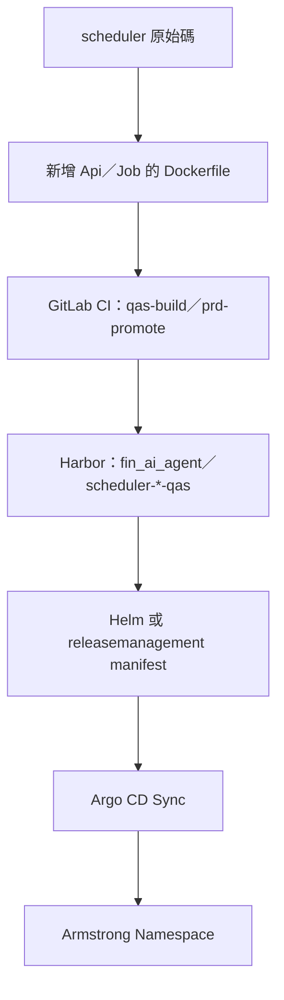
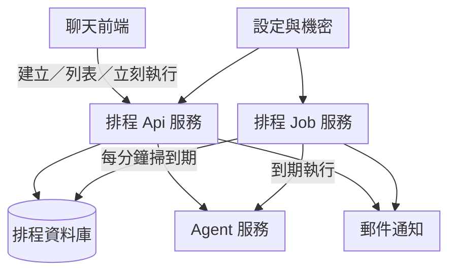

# 流程 2：Job 與 DB — 預估如何部署

對齊現有前後端慣例：GitLab CI 建映像 → Harbor → Helm／releasemanagement → Argo CD → Armstrong。  
**現況**：pipeline 只有 `server`／`frontend`；Scheduler **尚未**有 Dockerfile／CI job。本圖是目標態預估。

另見：[schedule-api.md](schedule-api.md)、[schedule-db.md](schedule-db.md)｜[gitlab_flow.md](gitlab_flow.md)｜[README](../README.md)

> 預覽：`Ctrl+Shift+V`。圖太小請用預覽縮放。

---

## 流程圖（從程式到叢集）

---

## 流程圖（叢集內誰連誰）

上→下單欄；草稿／正式通知、公司掃描開關等細節見圖下，不塞進圖裡。

---

## 圖下說明（請對照圖）

### A. 為什麼要拆 Api 與 Job 兩個 workload？

| 角色 | 職責 | 下線影響 |
|------|------|----------|
| **Scheduler Api** | 給 UI／內部呼叫：建立排程、列表、立刻執行 | 使用者無法改排程；已寫入 DB 的任務仍可被 Job 掃到 |
| **Scheduler Job** | Hangfire 宿主：每分鐘 due-scanner | 新任務不會自動跑；Api 的 run-now 若仍在同一進程才受影響（建議分開後 run-now 只在 Api） |

兩者應連**同一座**排程資料庫，避免「UI 看到的」和「Job 掃到的」不是同一份資料。

### B. 和前後端部署差在哪？

| | server／frontend（現有） | scheduler（預估要補） |
|--|-------------------------|------------------------|
| Dockerfile | 已有 | 需新增（Api／Job 各一，或明確的多階段） |
| `pipeline/qas.yaml` | `qas-build-server`／`frontend` | 需加 `SERVICE_NAME` 對應資料夾 |
| Harbor 路徑 | `…/fin_ai_agent/server-qas` 等 | 建議 `…/fin_ai_agent/scheduler-api-qas`、`scheduler-job-qas`（名稱以 SRE 為準） |
| Argo | 既有 App | 新增 Deployment＋連線設定；path 常見形如 `manifests/whq/arm-qas-01/<ns>/…` |

### C. DB 在部署裡放哪？

- **不要**把本機路徑 `D:\ai_prepare_data\schedules.sqlite` 帶上 K8s。  
- 預估改 **PostgreSQL**（與 LangGraph 用庫可分開實例，但都應是正式 DB 服務）。  
- 連線字串、`SCHEDULE_JOB_KEY`、Hangfire 密碼、正式 `NOTIFICATION_INVOKE_URL` → Secret／Vault；`CompanySchedules:Enabled`、`Notification:Mode` → ConfigMap／環境變數即可。

### D. 通知（郵件）部署注意

- 本機／預設：`Notification:Mode=Draft` → `DraftNotificationSender` **永不**打 Logic App。  
- 正式要實發：另實作 Http sender、設 `Mode=Http`，`InvokeUrl`（含 sig）只放 Secret；**不要** commit。  
- 收件 To／Cc 存在 `Schedules` 列，不是寫死在映像裡。

### E. 公司 Job「用設定關掉」怎麼對應部署？

- 不必刪掉 Deployment。  
- 將 `CompanySchedules:Enabled=false`（或 env `COMPANY_SCHEDULES_ENABLED=false`）後重載／重啟 Job Pod。  
- 效果：due-scanner **不再撿** `Scope=Company`；個人排程照常；DB 裡公司列仍在，只是不跑。

### F. 上線前檢查清單（預估）

1. CI 能推出 scheduler 映像到 Harbor  
2. Argo App Healthy／Synced，Api／Job Pod Ready  
3. Api `/health` 正常；Job `/hangfire`（若開放）可見 `ProcessDueSchedulesJob`  
4. 對 PG 執行 Migrate 後存在 `Schedules.Scope`、`EmailTo`／`EmailCc`／`NotifyEnabled`  
5. 建一筆個人排程可列表；公司列一般 userId 看不到  
6. 本機 Draft：`ScheduleRuns.NotifyOutcome` 可見 `Draft:…` 或 `Skipped:…`，信箱無實信  

實際專案名／Namespace 以 WiCOP 與 SRE 申請為準（文件中常寫 `finagent`／Harbor `k8sprdwhqfin-ai-agent`）。
