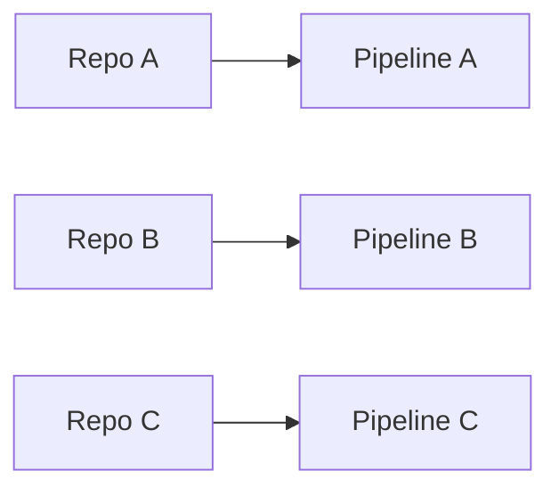

# GitLab Repository 管理模式比較

## Multi-Repo vs Monorepo

| 評估面向 | Multi-Repo | Monorepo |
|----------|------------|------------|
| 程式碼管理 | 分散管理 | 集中管理 |
| 版本控制 | 個別版本 | 統一版本 |
| 跨系統修改 | 需同步多個 Repo | 可一次完成 |
| 共用元件維護 | 容易產生版本差異 | 一致性較高 |
| Repository 規模 | 較小 | 持續成長 |
| 程式搜尋與追蹤 | 跨 Repo 搜尋 | 全域搜尋 |

> [!NOTE]
> **Multi-Repo 強調系統獨立性與管理；Monorepo 強調程式碼整合性與版本一致性。**

---

# CI/CD 與導入建議

## CI/CD 流程差異

### Multi-Repo

- 每個 Repo 擁有獨立 Pipeline
- 各系統可獨立 Build、Test、Deploy
- 管理簡單但需維護多套 Pipeline

---

### Monorepo

- 單一 Repository 共用 Pipeline
- 可依變更內容觸發特定模組建置
- 統一管理但 Pipeline 設計較複雜(但若量不多影響不大)

---

## 適用情境

| 項目 | Multi-Repo | Monorepo |
|--------|--------|--------|
| 系統獨立開發 | ✅ | |
| 權限隔離需求高 | ✅ | |
| 共用程式碼比例高 | | ✅ |
| 統一版本管理 | | ✅ |
| 大型平台型產品 | | ✅ |
| 跨模組頻繁修改 | | ✅ |

> [!TIP]
> **簡單維護，建議採用 Multi-Repo。**  
> **程式碼整合、版本一致性及統一 CI/CD 管理，建議採用 Monorepo。**
